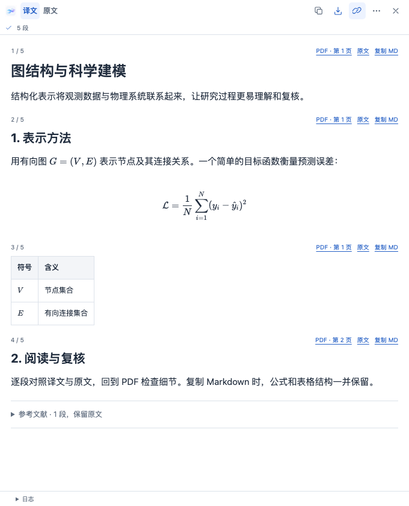
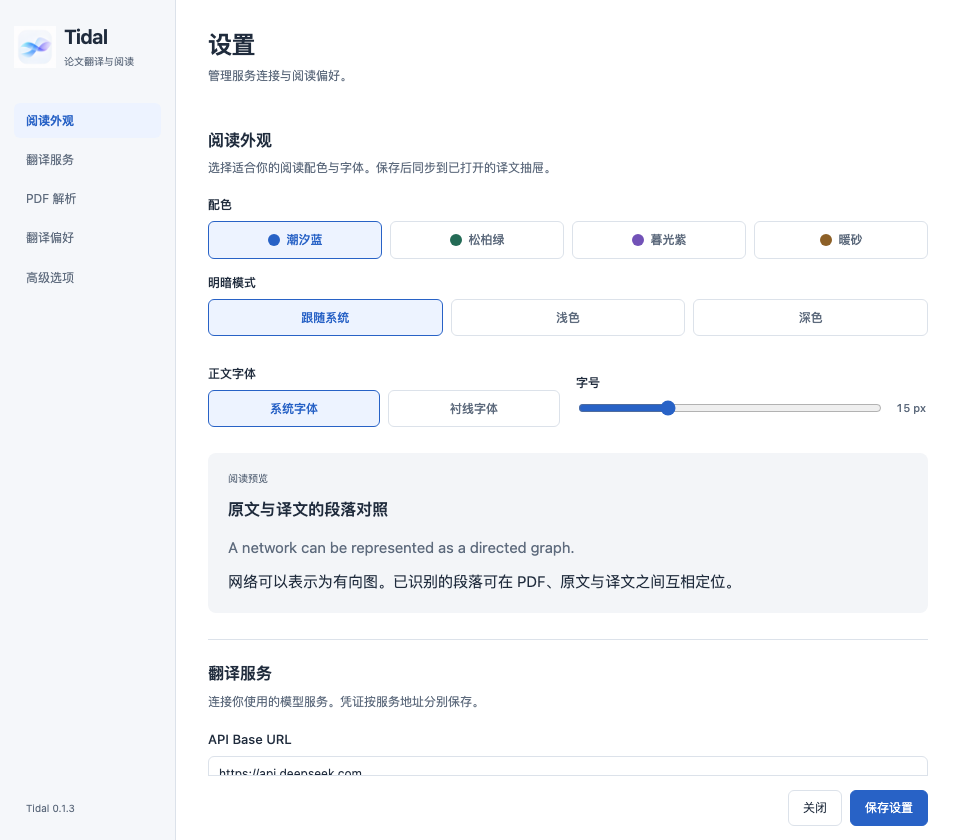

<p align="center">
  
</p>

<h1 align="center">Tidal</h1>

<p align="center"> 由 MinerU 与 LLM 驱动的一站式PDF论文解析/翻译器 </p>

<p align="center">
  
  
  <a href="LICENSE"></a>
</p>

## 能做什么

- **全文与选区翻译**：翻译整篇 PDF。
- **贴着 PDF 阅读**：可调宽、可换边的译文抽屉，支持 PDF、原文和译文之间的段落定位。
- **保留论文结构**：支持公式、代码、表格与图片显示，复制段落或全文 Markdown。
- **智能保留参考文献**：默认保留参考文献原文，也可改为按标题识别或全部翻译。
- **保存到 Zotero**：将双语 HTML、译文 Markdown 和翻译笔记关联到原文献。
- **复用历史结果**：已完成的段落及时缓存，重新打开直接阅读，未完成任务可手动继续。
- **按习惯阅读**：四种配色、浅色 / 深色 / 跟随系统模式，支持字体与字号调整。

**0.1.3 更新**：常用操作集中在紧凑工具栏，任务详情和次要操作放入“更多”，为正文留出更多空间。近期版本还加入了 Markdown 复制、持久历史、精简定位缓存和过程文件清理。

## 界面预览

译文阅读与段落工具：



外观与服务设置：




## 安装

1. 从本仓库的 **Releases** 下载 `tidal-0.1.3.xpi`。若尚未提供安装包，可按下文从源码构建。
2. 在 Zotero 的 **工具 → 插件** 中，点击齿轮菜单，选择 **从文件安装插件…**。
3. 选择下载的 XPI，安装后打开 **工具 → Tidal：设置…**。

清单声明兼容 Zotero **10.0.x**；已有原生验证记录来自 **macOS + Zotero 10.0.7**。其他系统和版本仍需验证，详见 [升级与兼容](docs/COMPATIBILITY.md)。当前通过手动安装 XPI 更新。

## 三步开始

### 1. 配置服务

在设置中填入自己的服务凭证，然后点击 **保存设置**。

| 用途 | 配置项 | 插件默认值 |
| --- | --- | --- |
| PDF 解析 | MinerU 地址、Token | `https://mineru.net/api/v4`，VLM |
| 翻译 | 服务类型、地址、模型、API Key | DeepSeek，`https://api.deepseek.com`，`deepseek-flash` |
| 翻译偏好 | 源语言、目标语言、参考文献策略 | 自动识别 → 简体中文，智能保留参考文献 |

也可选择 **Chat Completions 通用** 或 **Qwen-MT 兼容**，按服务要求填写地址和模型。上述模型为当前插件的默认配置，实际可用性以你的服务账号为准。术语表支持每行填写 `原文 = 译文`。

**全文翻译需要 MinerU Token 和翻译 API Key。** 可点击“测试翻译连接”检查当前填写的配置；它发送固定短句，不保存设置，可能产生一次 API 费用。

### 2. 开始翻译

- **全文**：选中文献或 PDF 附件，右键选择 **翻译论文 PDF…**。
- **选区**：在 PDF 阅读器中选中文字，点击选区工具栏的 **翻译选区**。

译文会在阅读器旁打开。收起后可用阅读器工具栏的 **译文** 按钮重新展开。

### 3. 阅读与保存

- 用 **译文 / 原文** 切换内容，开启 **段落联动** 后点击已识别段落即可定位对应内容。
- 在 **更多 → 段落工具** 中显示页码、原译文跳转和 **复制 MD**；没有可靠坐标的段落无法定位 PDF。
- 顶部复制图标复制当前侧的全文 Markdown；**更多 → 复制本段** 复制选中段落。选区复制按覆盖的完整段落处理。
- 完成后点击保存图标，回存 **双语 HTML + 译文 Markdown**；也可在 **更多 → 存为笔记** 中保存笔记。

## 历史与缓存

从 **工具 → Tidal：任务与历史…** 查看、搜索或删除记录，也可在阅读抽屉的“更多”中进入。

- 相同附件的 PDF 内容未改变时，优先复用已有结果，重新打开不会自动重新付费翻译。
- 修改默认语言、模型或参考文献策略，不会改变已有任务。要按新设置重做，先在历史中删除对应记录，再从 PDF 启动。
- 未完成任务需点击 **重试未完成段落** 继续。收起抽屉或关闭阅读标签，后台任务会继续；退出 Zotero 会取消本机未完成任务。
- **清理过程文件** 可移除空闲任务的下载包和中间文件，保留历史、正文、图片及定位结果。
- 删除历史需确认，保留原 PDF 和已回存到 Zotero 的附件、笔记。历史不会按时间或数量自动淘汰。

## 数据与凭证

全文翻译会将 PDF 发送到 MinerU，将解析文本发送到你配置的翻译服务；选区翻译只发送选中文字。使用前请确认文档适合发送给这些服务，API 费用由对应服务收取。

服务凭证按地址分别保存在 **Zotero 登录管理器**，不写入翻译任务缓存。更换服务地址时需要填写该地址对应的凭证；密码框留空会保留已存凭证，移除凭证请用设置中的“管理已保存的凭证”。

任务缓存位于 Zotero 数据目录下的 `paper-translator/`。此名称为兼容旧版本保留，详见 [升级说明](docs/COMPATIBILITY.md)。

## 从源码构建

需要 **Python 3.9+** 和 **Node.js 20+**。前端依赖及其许可证已随源码提供，无需运行 `npm install`。

在项目目录执行：

```bash
python3 tools/build.py
python3 tools/build.py --check dist/tidal-0.1.3.xpi
```

安装包输出到 `dist/tidal-0.1.3.xpi`。构建会检查脚本语法、XHTML、资源版本、依赖哈希和 XPI 完整性；大小与 SHA-256 写入本地 `reports/release.json`。


## 作者与许可

作者：https://github.com/YangyuTRUE

本项目采用 [MIT License](LICENSE)。第三方依赖保留各自许可证，见 [addon/content/vendor](addon/content/vendor)。
